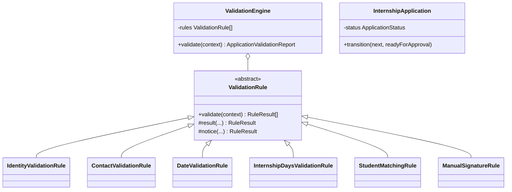

# OOP prensipleri — çalışan kod üzerinden

Bu proje soyut bir örnek sınıf listesi yerine API'nin gerçekten çağırdığı sınıfları kullanır.

## Encapsulation — Kapsülleme

`packages/shared/src/internship.ts` içindeki `InternshipApplication` sınıfının `#status` alanı dışarıdan yazılamaz. `status` getter'ı okuma sağlar; değişiklik yalnızca `transition(next, readyForApproval)` üzerinden yapılır.

İzin verilen durum sırası sınıf içinde tanımlıdır. UPLOADED → COMPLETED gibi atlamalar veya tamamlanmış başvuruya geri dönüş hata üretir. APPROVED ve COMPLETED geçişleri doğrulama hazır olmadan gerçekleşmez.

Express durum endpointi önce bu sınıfı çağırır, ardından MongoDB güncellemesini mevcut durum ve sürüm koşuluyla yapar. Böylece API üzerinden eşzamanlı istekler de kuralı atlayamaz. Veritabanına doğrudan yönetici müdahalesi bu API korumasının dışındadır.

## Abstraction — Soyutlama

`apps/server/src/validators/ValidationRule.ts` içindeki soyut sınıf ortak sözleşmeyi tanımlar:

```typescript
abstract class ValidationRule {
  abstract validate(context: ValidationContext): RuleResult[];
}
```

Çağıran kod kimlik kontrolünün, tatil hesabının veya imza kontrolünün ayrıntılarını bilmez. Yalnızca bağlamı verir ve aynı yapıda sonuçlar alır. Sonuç; kural kodu, kategori, alan, geçerlilik, önem düzeyi, hata türü ve öneri içerir.

## Inheritance — Kalıtım

`rules.ts` içindeki sınıflar `ValidationRule` sınıfından türer. Ortak `protected result()` ve `notice()` yardımcılarını kullanırlar. Bu yardımcılar geçerli sonuçların durumunu ve başarısız sonuçların öneri/önem düzeyini ortaklaştırır.

- `SchemaValidationRule`: temel form sözleşmesi.
- `StudentMatchingRule`: öğrenci veri setiyle eşleşme.
- `IdentityValidationRule`: TC/YKN ve isteğe bağlı checksum.
- `ContactValidationRule`: telefon/e-posta ve isteğe bağlı faks.
- `AddressValidationRule`: adres bileşenleri.
- `DateValidationRule`: tarih sırası ve teslim süresi.
- `AcademicYearValidationRule`: yıl, yarıyıl ve yapılandırılmış staj aralığı.
- `InternshipDaysValidationRule`: çalışma günleri, tatil kapsamı ve beyan edilen gün.
- `EngineerValidationRule`: mühendis ve çalışan sayıları.
- `EmployerValidationRule`: işveren/yetkili alanları.
- `ManualSignatureRule`: imza, kaşe ve boş olması gereken onay alanları.

## Polymorphism — Çok biçimlilik

`ValidationEngine` somut sınıfları `ValidationRule[]` olarak saklar ve hepsini aynı metotla çalıştırır:

```typescript
const results = this.#rules.flatMap(rule => rule.validate(context));
```

Her nesne kendi kuralını uygular. Yeni bir kural eklendiğinde motorun sonuç toplama, öneri çıkarma ve onay uygunluğu hesaplama kodu değişmez. Yeni sınıfın ortak sözleşmeyi uygulaması ve kural listesine eklenmesi yeterlidir.

## Sınıf ilişkileri



## Çalışma akışı

Öğrencinin formu sunucuda biçim doğrulamasından geçer ve telefon/e-posta alanları normalize edilir. Başvuru sahibinin User ve StudentProfile kayıtları sunucudan yüklenir; beklenen öğrenci bilgileri istemciden alınmaz. Kurallar aynı bağlamla çalışır ve rapor başvuruya bağlanır.

Manuel kontroller kaydedildiğinde rapor yeniden oluşur. Yönetici onay veya tamamlama istediğinde kayıtlı raporun olumlu olması tek başına yeterli değildir: kurallar güncel öğrenci verileriyle transaction içinde tekrar çalışır. Rapor, durum ve audit kaydı birlikte yazılır.

## Testte gösterimi

`tests/validation.test.ts` farklı somut kuralları gerçek alan değerleriyle sınar; ek bir kural sınıfının aynı sözleşmeyle çağrılabildiğini de gösterir. `tests/application.test.ts` geçersiz durum atlamalarını ve tamamlanmış başvurunun değişmezliğini sınar. `tests/validation.live.test.ts` olumlu rapor sonrasında veri seti değiştiğinde onay/tamamlamanın reddini gerçek Atlas üzerinde test eder.

Bu notlar sunum ve rapor için teknik temel sağlar; öğrencilerin kodu inceleyip kendi anlatımlarıyla açıklaması beklenir.
