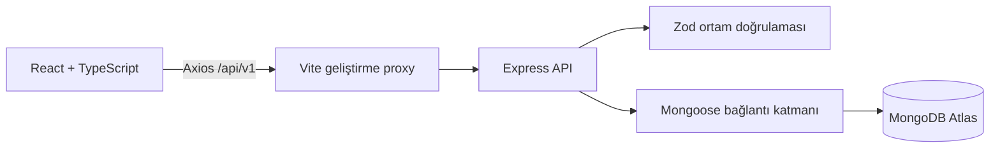

# Aşama 1 teslim notları

## Uygulananlar

Npm workspaces monorepo, React/Vite ve Express uygulamaları, TypeScript yapılandırmaları, Tailwind renk değişkenleri, shadcn/ui Button altyapısı, responsive Türkçe çalışma alanı, route yönetimi, API sorgusu ve durum bildirimleri, MongoDB Atlas bağlantı katmanı, ortam değişkenleri ve health/readiness API'leri.

## Mimari

Health sorgusu bağlantı durumunu Mongoose'dan okur. Veritabanı yokken bellek içi veya farklı bir veritabanına geçilmez. Liveness ve readiness ayrı endpointlerdir.

## Doğrulama sonuçları (6 Kasım 2026)

- `npm run typecheck`: istemci ve sunucu başarılı.
- `npm run build`: istemci ve sunucu başarılı.
- `npm test`: 3 API entegrasyon testi başarılı.
- Paket güncellemesi sonrası npm denetimi: 0 açık.
- Çalışan geliştirme sunucusu: arayüz HTTP 200, Vite proxy üzerinden health HTTP 200 ve `disconnected`, readiness HTTP 503.
- Tarayıcı görsel kontrolü yapılmadı.
- Kullanıcının sağladığı URI ile canlı Atlas bağlantısı ve `ping` komutu başarılı; kayıt oluşturulmadı. Logo eklendikten sonra üretim derlemesi yeniden başarılı.

## Sonraki aşama planı

Aşama 2: User ve StudentProfile modelleri, bcrypt, JWT, başarısız giriş kilidi, oturum geçersizleştirme, rol yetkilendirmesi ve giriş ekranı. Başvuru ve belge modelleri bu aşamada oluşturulmamıştır.

## Eksik dış girdiler

Proje PDF'si; gerçek Ek-16 DOCX; doğrulanmış resmî marka renkleri. Atlas bağlantısı sağlandı; logo kaynağı `branding.md` dosyasında kaydedildi.
